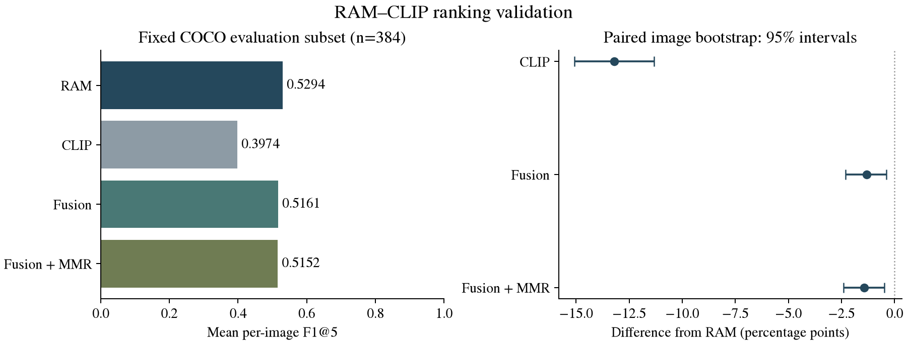

# RAM–CLIP tag reranking

An audit and reproducibility study of an MSc image-tagging notebook. The experiment asks whether fixed CLIP relevance scores and diversity selection improve the ordering of RAM tags on an explicitly defined object vocabulary.

The original code had confidence-extraction and evaluation errors. This revision separates a tested ranking implementation from a pretrained-model experiment. It does not carry forward unverified accuracy numbers from the thesis.

## COCO val2017 validation: 512 real images

The larger run processed 128 development images and a separate **384-image evaluation partition**, selected by a fixed hash rule before inference. Parameters stayed unchanged: fusion alpha=0.5, MMR relevance weight=0.8, and k=5. Results below refer only to the evaluation partition.

| Method | Mean P@5 | Mean recall@5 | Mean F1@5 |
|---|---:|---:|---:|
| RAM | 0.4297 | 0.8548 | 0.5294 |
| CLIP | 0.3151 | 0.6729 | 0.3974 |
| Fusion | 0.4167 | 0.8393 | 0.5161 |
| Fusion + MMR | 0.4156 | 0.8387 | 0.5152 |

**RAM remains the stronger baseline in this experiment.** Relative to RAM, fusion reduced mean F1@5 by 1.328 percentage points (paired 95% interval: -2.314 to -0.389); fusion + MMR reduced it by 1.424 points (-2.415 to -0.475). These intervals are per-comparison and unadjusted. The added stages are retained as documented ablations, not presented as accuracy improvements.



Read the [full report](reports/VALIDATION_512.md), [registered protocol](reports/VALIDATION_PROTOCOL.md), [raw outputs](reports/validation-512.json), [paired analysis](reports/validation-512-summary.json) and [evaluation CSV](reports/validation-512-evaluation.csv). The [exploratory class AP](reports/validation-512-class-ap.json) also favors RAM, but is separate from the primary endpoint.

Scoring uses 69 exact-name RAM/COCO categories. The evaluation retains 1,036 of 1,177 reference category positives (88.02%); 13 images have no in-vocabulary positive and remain in the denominator. No reference labels were generated or revised. Pretraining overlap is unknown; this is not a zero-shot claim or full COCO-80 benchmark.

The [data preparation check](reports/data-preparation-check.json) reproduced the frozen 512-image manifest byte-for-byte. [Native-query equivalence evidence](reports/subset-query-equivalence.json) and its [raw real-image run](reports/subset-query-pilot.json) document the computation optimization.

## Earlier eight-image integration pilot

Real RAM and CLIP CPU inference completed on all eight COCO photographs with original annotations and checksum-verified official checkpoints. On the fixed 69-label RAM/COCO intersection:

| Method | Mean P@5 | Mean recall@5 | Mean F1@5 |
|---|---:|---:|---:|
| RAM | 0.3000 | 0.9583 | 0.4435 |
| CLIP | 0.2500 | 0.8333 | 0.3720 |
| Equal-weight fusion | 0.3000 | 0.9583 | 0.4435 |
| Fusion + greedy MMR | 0.3000 | 0.9583 | 0.4435 |

**The proposed reranking did not improve these metrics over RAM in this pilot.** These observations are not a held-out benchmark. See the [raw full run](reports/full-pilot.json), [independent CLIP run](reports/clip-pilot.json), [environment](reports/environment.json) and [interpretation](reports/PILOT.md).

Read the [audit](reports/AUDIT.md), [fixed protocol](reports/PROTOCOL.md) and [data manifest](reports/data-manifest.json). The manifest contains hashes and existing object labels, not redistributed photographs.

## Ranking core

```sh
python -m pip install -e ".[test]"
python -m pytest -q
```

Fusion standardizes each image's RAM confidence and CLIP cosine vectors before combining them with equal weight. These normalized scores are ranking values, not calibrated probabilities. Greedy maximum marginal relevance recomputes the best remaining candidate after each selection; relevance weight is fixed at 0.8.

## Model experiment

The runner requires PyTorch 2.8, torchvision 0.23, timm 0.4.12, transformers 4.38.2, fairscale 0.4.13, ftfy, regex, and the official RAM/CLIP source trees. This combination completed the recorded CPU pilot. CPU execution with the original RAM checkpoint needs several GB of storage and memory.

Pinned sources:

- [RAM](https://github.com/xinyu1205/recognize-anything/tree/7cb804a8609e9f4b1a50b7f31436d2df40bb9481)
- [CLIP](https://github.com/openai/CLIP/tree/dcba3cb2e2827b402d2701e7e1c7d9fed8a20ef1)
- RAM weight revision: `xinyu1205/recognize_anything_model@ebc52dc741e86466202a5ab8ab22eae6e7d48bf1`

With those source directories on `PYTHONPATH`, verified weights and a local `bert-base-uncased` tokenizer:

```sh
python -m tag_research.experiment --data /path/to/coco8 --ram /path/to/ram_swin_large_14m.pth --clip /path/to/ViT-B-32.pt --tokenizer /path/to/bert-tokenizer --output results/pilot.json
```

The independently executable CLIP stage is:

```sh
python -m tag_research.clip_baseline --data /path/to/coco8 --clip /path/to/ViT-B-32.pt --ram-vocabulary /path/to/recognize-anything/ram/data/ram_tag_list.txt --output results/clip-pilot.json
```

The runner refuses mismatched weight hashes and records per-image scores, predictions and timings. It captures RAM's actual classifier logits and checks agreement with the official thresholded tags. Each model retains its own preprocessing. It never substitutes placeholder scores or inferred ground truth.

## Scientific scope

This code uses **RAM**, not RAM++. RAM already incorporates CLIP supervision in its original design; the additional CLIP reranking here is a separate inference-stage experiment. A frozen reranker does not train an attention decoder, alter the backbone's attention maps or establish recognition of unseen classes.

COCO8 comes from COCO train2017 and may overlap pretraining. Eight images are an integration pilot, not evidence of generalization. COCO annotations also omit many valid scene attributes. No claim of state-of-the-art performance or thesis benchmark reproduction is made.

## References

- [Recognize Anything: A Strong Image Tagging Model](https://arxiv.org/abs/2306.03514)
- [Open-Set Image Tagging with Multi-Grained Text Supervision (RAM++)](https://arxiv.org/abs/2310.15200)
- [Learning Transferable Visual Models From Natural Language Supervision (CLIP)](https://arxiv.org/abs/2103.00020)
- [SigLIP 2](https://arxiv.org/abs/2502.14786), a relevant newer comparison to consider in a separate experiment; not evaluated here.
- [COCO8 dataset documentation](https://docs.ultralytics.com/datasets/detect/coco8/)

Model code, weights and data retain their upstream terms. Original thesis PDFs, personal front matter and third-party image files are not included in the public package.

## Reproduce the larger validation

Use the pinned sources and verified weights above. The image-preparation command downloads the fixed 512-image selection and original annotations; it does not generate reference labels. Images stay local. COCO data retain the [dataset's terms and attribution](https://cocodataset.org/).

```sh
python tools/prepare_coco_validation.py --output data/coco-val-512
python -m tag_research.experiment --query-subset --data data/coco-val-512 --manifest data/coco-val-512/manifest.json --ram /path/to/ram_swin_large_14m.pth --clip /path/to/ViT-B-32.pt --tokenizer /path/to/bert-tokenizer --output results/validation-512.json
python -m tag_research.validation results/validation-512.json results/validation-512-summary.json
python -m tag_research.class_ap results/validation-512.json results/validation-512-class-ap.json
python tools/build_validation_report.py --reports results
python tools/render_validation.py results/validation-512-summary.json results/validation-512-plot
```

Plot rendering additionally requires matplotlib. On Windows, use a short build/temp path if the fairscale package build hits the platform's path-length limit; the recorded run used the complete fairscale 0.4.13 registry source on `PYTHONPATH`, without dummy dependency functions.

RAM scores are cached every eight images and checked against the frozen image/label manifest before resuming. The query-subset mode is validated against native RAM outputs and is recorded in the result. Use a separate output path when comparing native and subset-query execution; cache modes cannot be mixed.
